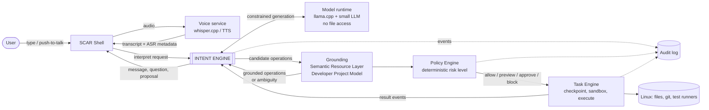
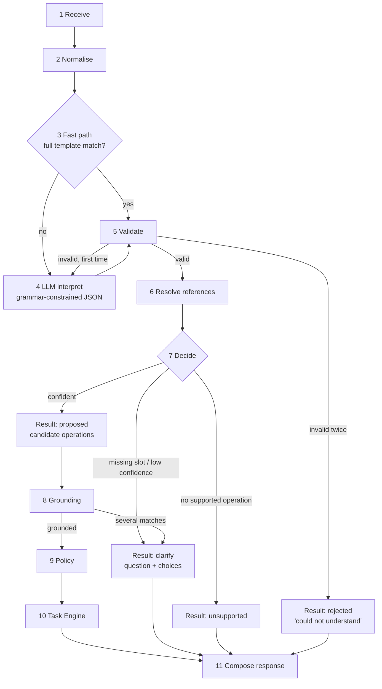

# SCAR OS Intent Engine: Architecture

| | |
|---|---|
| Project | SCAR OS: An AI-Centred, Developer-Focused Operating Environment (FYP 23F-02) |
| Owner | SCAR-OS Development Team |
| Status | Draft for team approval. Nothing in this document is implemented. |
| Date | 12 November 2026 |
| Sources | Proposal (16 Sep 2026), SRS 23F-02 v1.0 (Nov 2026), defence evaluation plan and Q&A bank (Oct 2026), tech-stack review, competitor research report |

Progress is tracked only in `MILESTONES.md`. Design choices and their reasons are in `TECHNICAL_DECISIONS.md` (TD-xx). Features are specified in `FEATURE_SPECIFICATION.md` (IE-xx).

Labels used in this document:

- **[SRS]** confirmed by the proposal or SRS.
- **[DEF]** stated in the defence material (speaker script, evaluation appendix, Q&A bank).
- **[REC]** our technical recommendation, not yet approved.
- **[APPROVAL]** changes or extends something already submitted, so it needs a team decision.

---

## 1. What the Intent Engine is

The Intent Engine is the SCAR service that turns one user request, typed or transcribed, in English, Urdu or mixed Urdu-English, into **validated candidate operations** in a fixed schema, or into a clarification question, or into an honest "not supported". [SRS FR-03, FR-04, FR-05]

It is a translator with a strict output format. It is not an agent.

Three rules from the SRS define its limits:

1. It **proposes**. It never executes anything and its output never reaches a shell. [SRS FR-04, NFR-14]
2. It does **not resolve real paths**. Grounding does that (Semantic Resource Layer and Developer Project Model). [SRS §3.2]
3. It does **not assign risk or grant permission**. The Policy Engine does that with deterministic rules. [SRS FR-18]

These three rules are the reason the engine can use a small, imperfect language model safely: the worst a wrong interpretation can do is produce a wrong *proposal*, which still has to pass grounding, policy, preview or approval, and can be rolled back.

## 2. Responsibility boundaries

The request listed many possible capabilities. Each is placed below with the reason.

### 2.1 Core of the Intent Engine

| Capability | Why it belongs here |
|---|---|
| Input normalisation (Unicode, script and language tagging, Roman-Urdu spelling variants) | Interpretation quality depends on it and no other component needs it. |
| Intent recognition (which operation) | This is the engine's purpose. [SRS FR-03] |
| Parameter extraction (target description, destination, new name, project) | Same model call or same rule as recognition; separating them would double latency. |
| Command interpretation for fixed commands ("undo the last task", "switch to developer mode", "open the second one") | Closed phrasing, must be instant and must never be misread. Handled by deterministic rules. [REC TD-05] |
| Output validation against the schema and operation catalogue | The SRS places this before anything else sees the output. [SRS FR-04] |
| Decomposition of one request into a short ordered list of operations | The schema allows "one or more candidate operations". [SRS FR-03, DEF Q&A 3.5] |
| Deciding to ask, propose or refuse (clarification and abstention) | "Prefer asking over acting wrongly" is an Intent Engine quality target. [SRS FR-05, NFR-03] |
| Conversation state for the **current request only** (pending question, last result list, last task) | Needed for "the second one" and "it". Kept small on purpose. [DEF Q&A 3.7] |
| Wording of responses and clarification questions | The engine knows what it understood; templates keep this deterministic. |

### 2.2 Supporting services (separate SCAR processes the engine calls or is called by)

| Capability | Owner | Reason |
|---|---|---|
| Speech-to-text and text-to-speech | Voice service | The engine consumes text. Keeping speech outside lets typed input work when voice fails and lets ASR errors be measured separately. [DEF Q&A 2.9] |
| Running the language model | Model runtime (llama.cpp) as its own process | A separate process can be sandboxed with no file access, restarted on failure and swapped without touching the engine. [REC TD-03] |
| Grounding: description to real files, projects, commands | Semantic Resource Layer, Developer Project Model | They own the index. The model must never invent a path. [SRS §3.2, DEF Q&A 1.4] |
| Tool and service discovery | Operation catalogue (a static, versioned file) | A closed list is a security property, not a limitation. Discovery at run time would let the model reach tools nobody reviewed. [SRS "closed list"] |

### 2.3 Other SCAR components (not Intent Engine work)

| Capability | Owner | Reason |
|---|---|---|
| Permission and authorization | Policy Engine | Must be deterministic and must not depend on the model. [SRS FR-18 to FR-23] |
| Task identity, checkpoint, execution, sandbox | Task Engine | Only the Task Engine may request file-changing operations. [SRS §3.3] |
| Execution verification and rollback | Task Engine and recovery | Verified with file hashes, not by asking the model. [SRS FR-28] |
| Audit log | Audit subsystem | Append-only and hash-chained. The engine only emits events. [SRS FR-27, NFR-20] |
| Approval dialogs, task panel, mode switch | SCAR Shell | The engine supplies content; the Shell owns the screen. [SRS FR-34 to FR-37] |
| Private Space enforcement | Policy Engine and OS rules | The engine never sees Private Space content, so it has nothing to enforce. [SRS FR-31, FR-32] |

### 2.4 Operating-system responsibilities

Process isolation (Landlock, systemd hardening), IPC transport (Unix domain sockets), audio (PipeWire), filesystem snapshots (Btrfs), service supervision (systemd user services). The engine uses these and does not reimplement them.

### 2.5 External integrations

llama.cpp and a quantised open model, whisper.cpp, a TTS engine. All are replaceable behind a small interface. [SRS "candidate / reference technology"]

### 2.6 Optional future enhancements (not in the first version)

Learning from user corrections, long-term memory, a general multi-step planner or agent loop, run-time tool discovery, MCP export of the catalogue, fine-tuning. See `FEATURE_SPECIFICATION.md` section F for why each is deferred or excluded.

## 3. System context



Plain-text view of the same path:

```
User -> Shell -> [Voice service] -> INTENT ENGINE -> Grounding -> Policy Engine -> Task Engine -> Linux
                                        |  ^                                          |
                                  Model runtime                                 result events
                                 (no file access)                                     |
                                        +---------- response to Shell <---------------+
```

Whether grounded operations go to the Policy Engine directly or back through the Intent Engine is an open interface question for the SDS (see section 12, Q-A1). The diagram shows the SRS wording: grounded operations go to the Policy Engine. [SRS §3.2]

## 4. Pipeline

The conceptual pipeline in the brief had thirteen steps. Seven belong to the engine, six to other components. The revised pipeline:

| # | Stage | Owner | Uses a model? |
|---|---|---|---|
| 1 | Receive request (text, or transcript with ASR confidence and language) | Intent Engine | No |
| 2 | Normalise: Unicode NFC, whitespace, script detection, Roman-Urdu spelling variants, length limit | Intent Engine | No |
| 3 | Control and fast path: deterministic templates for fixed commands and unambiguous simple requests | Intent Engine | No |
| 4 | Interpret: constrained generation of candidate operations when the fast path does not match | Intent Engine + model runtime | Yes |
| 5 | Validate: schema, operation catalogue, mode, slot types, operation count limit; one retry | Intent Engine | No |
| 6 | Resolve references ("the second one", "it") against session state | Intent Engine | No |
| 7 | Decide: propose, ask, or report unsupported | Intent Engine | No |
| 8 | Ground descriptions to real resources; report ambiguity | Grounding services | Embeddings only |
| 9 | Classify risk and authorize | Policy Engine | No |
| 10 | Checkpoint, execute in sandbox, verify | Task Engine | No |
| 11 | Compose response (visual text and short speech text) from result events | Intent Engine | No |

Only stage 4 uses the language model, and only when stage 3 does not already have a certain answer. This follows the project rule that a model is not assumed for every operation, and it matters on CPU-only hardware where one model call costs seconds. [SRS §2.7, DEF evaluation plan Part A]



## 5. Components

| Component | Responsibility | Essential for first working version? |
|---|---|---|
| `contracts` | Typed schemas for every message; JSON Schema export; version number | Yes |
| `catalogue` | The closed list of operations: name, slots, required slots, mode, examples per language | Yes |
| `normalise` | Stage 2 | Yes (English and basic Roman Urdu); lexicon grows later |
| `rules` | Stage 3. Also serves as the pre-registered rule-based baseline of the evaluation plan [DEF B3] | Yes |
| `llm` | Client for the model runtime, prompt builder, grammar generated from the schema, timeouts | Yes |
| `validate` | Stage 5 | Yes |
| `dialogue` | Session state, reference resolution, clarification state machine | Minimal version yes (missing-slot question); full version later |
| `decide` | Confidence calculation and thresholds | Simple version yes; calibrated version later |
| `compose` | Response templates | Yes (English); Roman Urdu later |
| `service` | JSON-RPC server on a Unix socket, health, peer check | Later. The first version runs as a library and CLI. |
| `events` | Emits audit and trace events | Trace file first; audit integration later |
| `reference` (outside the engine package) | Minimal stand-ins for grounding, policy and executor so the engine can be demonstrated before the real components exist | Yes, clearly marked as stand-ins |

### 5.1 Essential first, added later

**First working version (end of Phase 3 in `MILESTONES.md`):** typed English and Roman-Urdu requests, twelve operations, rule matcher plus LLM interpreter, validation, missing-slot clarification, a command-line interface, stand-in grounding on a fixture folder, a policy table and a dry-run executor that prints what would happen. Nothing is changed on disk by this version.

**Added later, in this order:** code-switched robustness and calibrated abstention, session references and multi-operation requests, the IPC service and integration with the real Policy and Task Engines, security hardening, the voice path, the Shell.

## 6. Contracts

All messages are UTF-8 JSON, validated on receipt, with a `schema_version`. [SRS §3.3]

### 6.1 Request (Shell to Intent Engine)

```json
{
  "request_id": "r-7f3a",
  "session_id": "s-01",
  "text": "Meri FYP wali documents submission folder main move karo",
  "source": "typed",
  "asr": null,
  "mode": "simple",
  "reply_to": null
}
```

- `source`: `typed` or `voice`. For voice, `asr` carries `{ "language": "...", "confidence": 0.0-1.0 }` from the voice service.
- `mode`: `simple` or `developer`. [SRS FR-37]
- `reply_to`: set when the text answers a pending clarification.

### 6.2 Candidate operation (as fixed in SRS §3.2)

```json
{
  "op": "move",
  "target": { "description": "my FYP documents", "kind": "file" },
  "project": null,
  "parameters": { "destination": "submission folder" },
  "language": "ur-en",
  "confidence": 0.86
}
```

`op` is one of the supported types. The twelve in the SRS are: `open`, `find`, `move`, `copy`, `rename`, `create_folder`, `delete`, `list_recent`, `summarise_file`, `git_status`, `run_tests`, `open_project`. The SRS states that the set may grow in the SDS.

Proposed additions to the operation object [REC, APPROVAL because it extends SRS §3.2]:

| Field | Purpose |
|---|---|
| `target.ref` | A reference instead of a description, for example `{ "ref": "last_results", "index": 2 }` for "the second one". Resolved by the engine, never by the model's memory of file names. |
| `origin` | `user_request` always, for operations from the interpreter. Carried so the Policy Engine can apply FR-22. |
| `interpreter` | `rules` or `llm`, plus prompt and model version. Needed to reproduce a result. |

`confidence` stays in the schema but is **computed by the engine**, not written by the model (section 8). [REC TD-07]

### 6.3 Interpretation result (Intent Engine to Shell and grounding)

The SRS defines the operation but not the envelope around it. Proposed envelope [REC]:

```json
{
  "request_id": "r-7f3a",
  "schema_version": "0.1",
  "status": "proposed",
  "operations": [ { "...": "candidate operation" } ],
  "clarification": null,
  "message": { "text": "Move your FYP documents to the submission folder?", "speech": "Move FYP documents to submission folder?" },
  "trace_id": "t-91c2"
}
```

`status` is exactly one of:

| Status | Meaning | `operations` | Next step |
|---|---|---|---|
| `proposed` | Valid candidate operations | 1 to N | Grounding, then Policy |
| `clarify` | The engine needs an answer first | empty | Shell shows `clarification.question` with `choices` |
| `unsupported` | The request is understood as something SCAR OS does not do | empty | Shell shows the message; nothing else happens |
| `rejected` | Output was invalid twice, or input broke a limit | empty | Shell shows "could not understand"; logged [SRS UC-01 3a] |
| `control` | A fixed command for another component (undo, cancel, switch mode) | one control item | Routed to Task Engine or Shell |

### 6.4 Grounding handshake

The engine sends each candidate with a description. Grounding returns one of: `resolved` (real paths, canonical), `ambiguous` (up to five candidates with path, type, date, snippet), `not_found`. On `ambiguous` the engine opens a clarification with choices. On `not_found` it says so and suggests refining the description. [SRS UC-02 2a, UC-04 2a]

### 6.5 Result events (Task Engine to Intent Engine)

`task_started`, `task_step`, `task_completed`, `task_failed`, `task_rolled_back`, `blocked` (from policy, with reason). The engine uses them to compose the final response and to update session state. It does not verify execution itself.

### 6.6 Interface methods

| Method | Direction | Purpose |
|---|---|---|
| `intent.interpret` | Shell to engine | Section 6.1 to 6.3 |
| `intent.reply` | Shell to engine | Answer to a pending clarification |
| `intent.cancel` | Shell to engine | Drop the pending request and its state |
| `intent.notify_result` | Task Engine or Policy Engine to engine | Section 6.5 |
| `intent.health` | Any SCAR service to engine | Model loaded, versions, last error |

Transport: JSON-RPC 2.0 over a Unix domain socket in the user's runtime directory, owner-only permissions, peer credential check. This is the SRS reference design. [SRS §3.3, NFR-21] The tech-stack review recommended D-Bus instead; see TD-08.

## 7. The interpreter

### 7.1 Rule path (stage 3)

A set of templates per operation and language form, written by the team. A template fires only when it matches the **whole** normalised request and every required slot is filled. A partial match never fires; the request goes to the model instead.

It has two jobs:

1. It is the **baseline** that the evaluation plan already requires ("a keyword/regex rule matcher, one rule set per operation type"). [DEF B3]
2. It is the **fast path** in the running system for fixed commands and simple unambiguous requests, answering in milliseconds. [REC TD-05]

The same design is used in practice by Home Assistant's Assist, which matches sentence templates locally and falls back to a language model only when no template matches.

### 7.2 Model path (stage 4)

One call to a small local model with:

- a fixed instruction,
- the operation catalogue (names, slots, one-line meanings) generated from the catalogue file,
- a few examples per language form drawn from the development set, never the test set [DEF Q&A 3.3],
- a small typed context: mode, whether a result list exists and its length, whether a task is pending,
- the user's request.

Decoding is grammar-constrained (llama.cpp GBNF generated from the JSON Schema), temperature 0, fixed seed, reasoning mode off, a hard token limit and a wall-clock timeout. The grammar guarantees the *format*; it does not guarantee the *meaning*, which is what the evaluation measures. [DEF Q&A 3.2]

The grammar also allows the model to answer `clarify` or `unsupported` instead of an operation. Giving the model a legal way to say "I am not sure" is the main defence against forced wrong guesses.

### 7.3 What never goes into the interpreter prompt

File contents, file names, folder names, README text, code comments, previous model output, or the audit log. The SRS classes all of these as data that must not drive operations. [SRS FR-22] If they are never in the prompt, they cannot inject instructions into the interpreter. References to earlier results are expressed as `ref` values and resolved by ordinary code (section 6.2).

### 7.4 No agent loop

The engine makes one interpretation call per request (two if the first output is invalid). It does not run a think-act-observe loop in which the model reads tool output and decides the next step. Reasons:

- **Latency.** Each model call costs seconds on a CPU. A loop multiplies that. [SRS §2.7]
- **Reliability.** Small quantised models degrade quickly over multi-turn tool use; published desktop-agent benchmarks show low success even for large models. [SRS §2.1, refs 3 and 22]
- **Security.** A loop that feeds tool output back to the model is the standard route for indirect prompt injection. A plan fixed from the user's words before any file is read cannot be changed by what a file says. This is the control-flow idea behind CaMeL (Debenedetti et al., 2025).

Multi-step requests are therefore handled as a **short ordered list produced in one call** and validated as a whole (limit proposed: five operations).

## 8. Confidence and the decision to ask

The SRS schema contains `confidence`, and FR-05 requires a question when confidence is low. A number written by a small model about its own answer is not a reliable signal. Proposed [REC TD-07]: the engine computes confidence from things it can observe:

| Signal | Effect |
|---|---|
| Rule path matched a full template | High |
| A required slot is missing | Always ask, regardless of other signals |
| Rule path and model path disagree on the operation (when both produce one) | Lower |
| Token probability of the `op` value, if the runtime exposes it | Scales the value |
| Voice input with low ASR confidence | Lower; show transcript for confirmation first [SRS UC-01 2a] |
| Grounding returned several close matches | Ask with choices |

Thresholds are set on the development set to keep the wrong-action rate inside the SRS target (≤ 2%), accepting more questions as the cost. They are frozen before the test run. [SRS NFR-03, DEF B8]

## 9. Session state and context

Kept in memory per session, small and typed:

- `pending`: the request waiting for a clarification answer (at most one). [SRS §3.3 "one approval request at a time"]
- `last_results`: the ordered list of result identifiers from the last `find` or `list_recent` (identifiers, not names).
- `last_target`: the resource identifier used by the last operation.
- `last_task_id`.
- `mode`, `active_project` (identifier).

It expires after a period of inactivity and on `intent.cancel`. It is not long-term memory, and conversation history is not fed to the model. [DEF Q&A 3.7]

## 10. Error handling

The rule everywhere is the SRS fail-safe rule: on any error, timeout or doubt, **ask or decline, never act**. [SRS NFR-11]

| Failure | Behaviour |
|---|---|
| Empty, over-long or non-text input | `rejected` with reason; logged |
| Model output invalid (for example cut off by the token limit) | One retry; then `rejected` [SRS UC-01 3a] |
| Model runtime not running or crashed | Rule path still answers what it can; otherwise "language model unavailable", no proposal |
| Model call exceeds the time limit | Cancel the call; same as above |
| Operation not allowed in current mode | `unsupported` with a suggestion to switch mode [SRS UC-08 1a] |
| Reference cannot be resolved ("the second one" with no list) | `clarify` |
| Grounding unavailable | "cannot look up files right now"; no proposal |
| Clarification answer does not match a choice | Ask once more, then cancel the request |
| Engine restarts with a pending question | Pending state is dropped; nothing was executed, so nothing is lost |

Every outcome produces a trace record (section 13).

## 11. Security boundaries

| Boundary | Enforcement |
|---|---|
| Model output never becomes a command | The only output type is the schema; there is no code path from the engine to a shell. Checked by a static test that fails the build if process-spawning APIs appear in the engine package. [SRS NFR-14] |
| The model cannot read files | The model runtime runs as a separate unprivileged process with no access to the home directory except its model file, and no network. [SRS NFR-15, NFR-19] |
| File content cannot steer interpretation | Section 7.3. |
| `summarise_file` cannot create operations | The summary is a **separate model call** whose output type is plain text for display only. It has no channel to return an operation. See below. |
| Closed operation list | Catalogue is a versioned file read at start; not writable by SCAR-AI processes. |
| Local callers only | Owner-only socket and peer check. [SRS NFR-21] |
| Private Space | The engine receives no Private Space content because grounding does not index it. A request that names it is passed on and blocked by policy without revealing content. [SRS FR-33] |

**About UC-05.** The SRS use case describes the model returning "the summary and an extra operation copied from the README", which the Policy Engine then blocks. The design above is stricter: the summary call cannot return an operation at all, so the injected instruction has nowhere to go. The Policy Engine remains the backstop and the injection tests still run unchanged. This is a strengthening, not a scope change, but the SDS wording should describe it. [APPROVAL]

## 12. Integration points with the operating system

| Point | Mechanism | Phase |
|---|---|---|
| Service lifetime | systemd user unit, restart on failure | 6 |
| IPC | Unix domain socket in `$XDG_RUNTIME_DIR` | 6 |
| Model process isolation | systemd sandboxing options and Landlock | 6 |
| Voice | Voice service delivers transcripts; audio via PipeWire is outside the engine | 7 |
| Desktop | SCAR Shell (GTK) is the only user-facing surface | 9 |
| Logs | Structured trace file; journald for service logs; audit events to the audit subsystem | 1 and 6 |

Open interface questions for the SDS:

- **Q-A1.** Does grounded output go from grounding straight to policy (SRS wording), or back through the engine? Affects who owns the clarification on ambiguity.
- **Q-A2.** JSON-RPC over Unix sockets (SRS reference) or D-Bus (tech-stack review) for service-to-service calls.
- **Q-A3.** Who owns control commands such as "undo the last task": a thirteenth operation, or a separate control message (section 6.3)?

## 13. Observability

Each request writes one trace record: request id, normalised text, language tag, path taken (rules or model), prompt version, model file hash, raw model output, validation result, decision, timings per stage. Traces are local files, never transmitted. Raw audio is never stored. [SRS UC-01 post-conditions]

The trace is what makes an evaluation result reproducible and a wrong interpretation debuggable.

## 14. Gaps found between the SRS and a working engine

These are not errors in the SRS; they are details that the design phase has to settle. Each is tracked as an open decision in `MILESTONES.md`.

| # | Gap | Proposed handling |
|---|---|---|
| 1 | The SRS use cases contain spoken commands that are not among the twelve operations: "undo the last task" (UC-06), "switch to developer mode" (UC-08), "open the second one" (UC-02). | Control commands and references, handled by rules (sections 6.2, 6.3). |
| 2 | FR-17 and the risk table mention a "code-structure query", but no such operation is in the list. | Add `find_symbol` in the SDS. The pre-registered test covers twelve types, so the addition is evaluated separately. [APPROVAL] |
| 3 | The schema has no way to express a question, an unsupported request or several operations. | Result envelope (section 6.3). |
| 4 | `confidence` has no defined source. | Engine-computed (section 8). |
| 5 | FR-03 accepts Urdu script, but the evaluation plan tests English, Roman Urdu and code-switched only. | Add a small exploratory Urdu-script set with no target. [APPROVAL] |
| 6 | NFR-01 gives an end-to-end latency target but no share for the engine. | Set an internal budget after the first measurement on the reference laptop (Phase 3). |
| 7 | Whether a spoken "yes" may approve a High-risk operation is not stated. | Recommend approval by explicit on-screen action only for High; spoken confirmation allowed for Medium preview. [APPROVAL] |
